# NVGM — English Screenshot Gallery

[Back to README / READMEへ戻る](../../README.md)

**27 close-up screenshots · 27枚の英語版実機接写**

Browse each feature below. Click a picture to open it at full size. / 各カテゴリを開き、画像をクリックすると原寸で確認できます。

> Captured with NVGM 2.4.3 and Victoria 3 1.13.11, English, UI 130%. These features remain in 2.4.4. The removed support stop/repair decisions are excluded. Screenshots are real in-game crops, recompressed as JPEG for GitHub; the UI has not been redrawn.

> NVGM 2.4.3・本体1.13.11・英語設定で撮影。2.4.4で維持している機能を掲載しています。削除した支援停止・修復の画像は除外しました。実機画像の接写をGitHub向けにJPEG化しており、UIの描き換えは行っていません。

## Start here / 最初に読む

Use the index to jump to a feature. Each section explains its purpose, entry point and important conditions before the screenshots. / 目次から機能を選ぶと、使い方・入口・注意点と実機画像を確認できます。

**Treaties:** draft articles in the recipient country screen. **Buildings & companies:** use the construction and company panels. **Journals:** start through Decisions. / **条約：** 相手国画面から草案を作成。**建物・企業：** 建設・企業画面。**ジャーナル：** ディシジョンから開始。

## Feature index / 機能一覧

| Category | Pictures |
|---|---|
| [Subjects — 従属国管理](#subjects) | 2 |
| [Treaties — 移譲・助成条約](#treaties) | 5 |
| [Buildings — 道路・病院](#buildings) | 3 |
| [Companies — 医療企業](#companies) | 1 |
| [Journals & Events — ジャーナルとイベント](#journals) | 6 |
| [Diplomacy — 外交支援](#diplomacy) | 5 |
| [Statistics — NVGM Menu](#statistics) | 5 |

[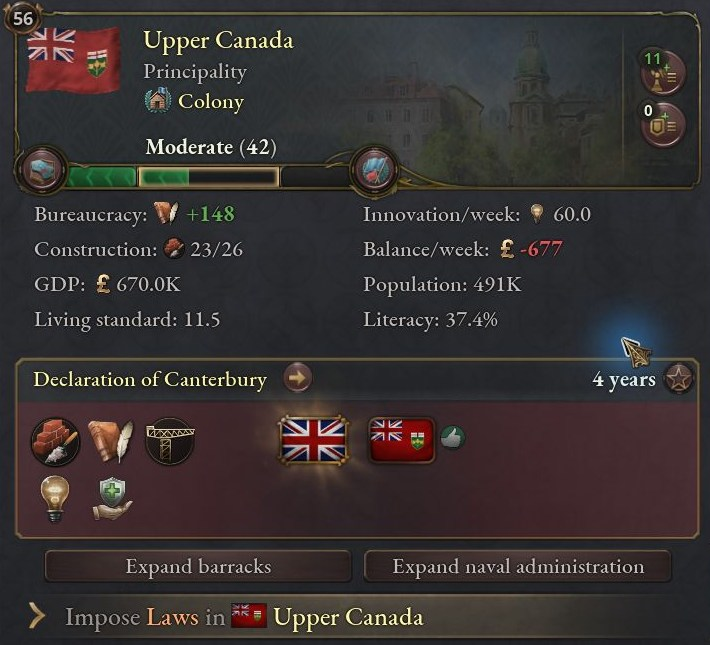](images/03_subject_card_with_treaty.jpg)

## Subjects — 従属国管理

**What it adds:** the vanilla subject card gains bureaucracy balance, innovation, construction, weekly balance, GDP, population, living standards and literacy, followed by active treaties and expansion buttons. Use the treaty entry to inspect its articles. Barracks and naval administration buttons issue construction orders; individual queue cancellation remains available.

**追加内容：** バニラの従属国カードに行政力収支・革新・建設力・週次資金収支・GDP・人口・生活水準・識字率を追加。締結中の条約から条項を確認できます。兵舎・海軍管理局の拡張は建設を指示する機能で、キューの個別キャンセルは可能です。

View screenshots / 画像を見る（2枚）

### Subject statistics at a glance

従属国の行政力・革新・建設力・経済

[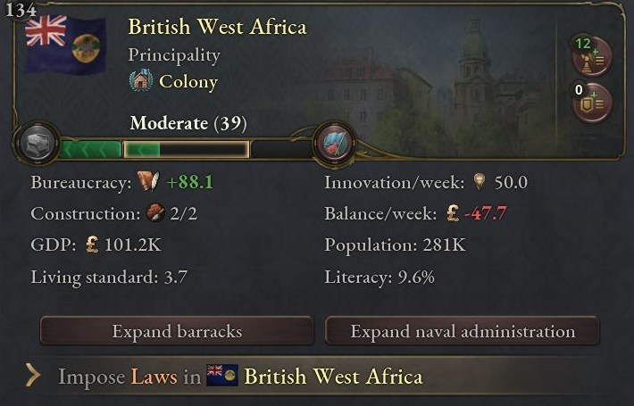](images/02_subject_statistics.jpg)

### Subject statistics, active treaty and expansion buttons

従属国カード・条約・兵舎と海軍管理局の拡張

## Treaties — 移譲・助成条約

**Where to start:** open the recipient country → draft a treaty → choose an article under Your Articles. Construction, bureaucracy, innovation and shipbuilding capacity can be transferred to direct subjects: enter the amount, check the donor's spare capacity, then add the article. The donor loses the same amount the recipient receives. Shipbuilding capacity is different from transferring completed ships.

**Industry Subsidy Commitment:** choose an industry for the subject to subsidize at its own expense, including newly built buildings of that industry. Funding is separate: combine the agreement with vanilla Money Transfer. There is no automatic full reimbursement of actual subsidy costs. Ending the agreement removes subsidies started by the MOD while preserving those already active before it.

**入口：** 相手国 → 条約の草案 → あなたの条項。建設力・行政力・革新・艦船建造能力を直接の従属国へ移譲できます。数量を入力し、提供国の余力を確認して追加してください。提供側から同量が差し引かれます。完成した艦船の転属とは別機能です。

**産業助成：** 業種を選び、従属国の費用で助成を実施します。同種の新設建物も対象です。資金を出す場合はバニラの送金条約を併用してください。助成実費の全額自動補填はありません。終了時はMODが開始した助成を解除し、開始前からの助成は維持します。

**Timing / 反映時期：** Changes normally apply on the next game day. A modifier showing 3 days is refreshed daily; it is not the treaty's remaining duration. / 変更・終了は原則翌ゲーム日に反映。補正の「3日」は毎日更新する期限で、条約の残り期間ではありません。

View screenshots / 画像を見る（5枚）

### Signed capacity and subsidy treaty

締結済みの移譲・助成条約

[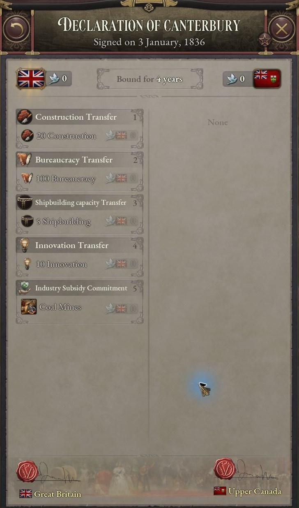](images/01_signed_treaty.jpg)

### Four directly editable transfer quantities

建設力・行政力・艦船建造能力・革新の直接入力

[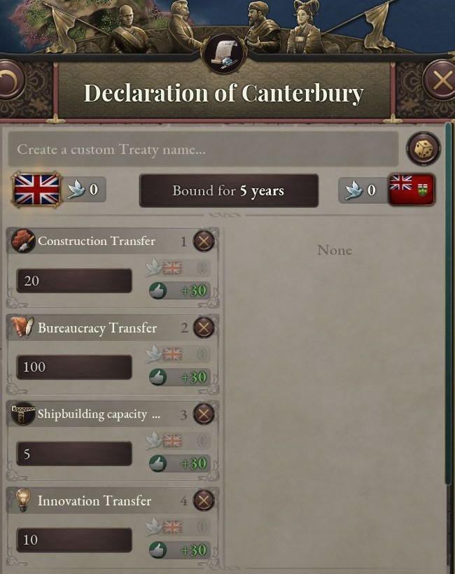](images/04_capacity_quantity_inputs.jpg)

### Subsidy commitment and funding explanation

産業助成と資金負担の説明

[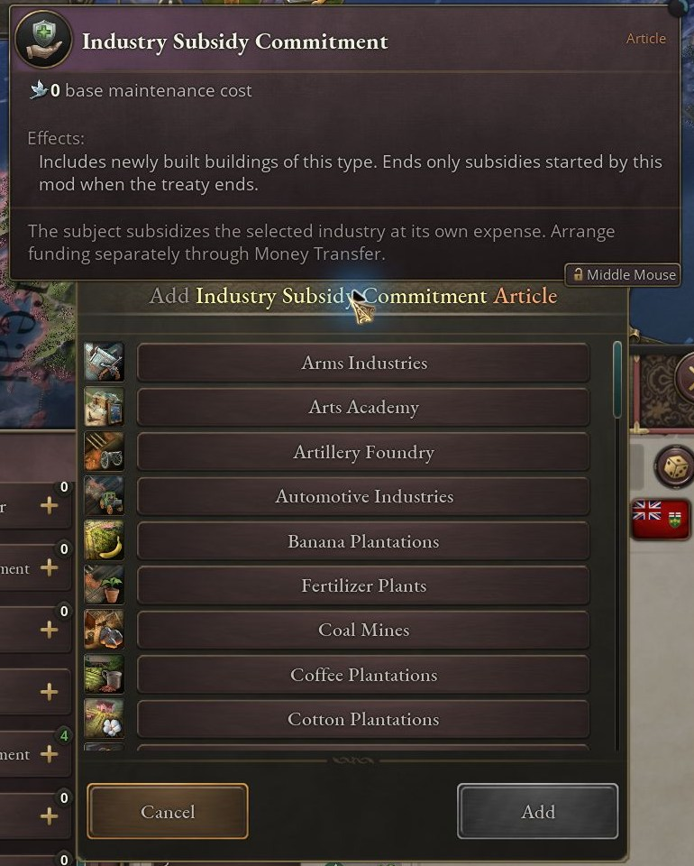](images/05_subsidy_selection_and_help.jpg)

### Choose the industry to subsidize

産業助成の対象選択

[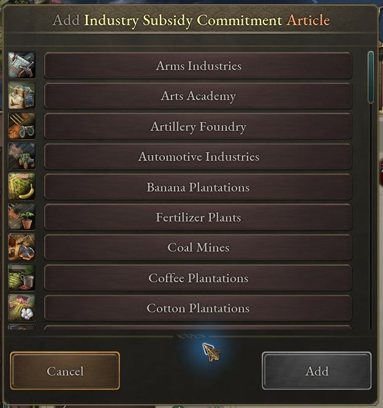](images/06_subsidy_industry_selection.jpg)

### Enter a construction transfer quantity

建設力20の直接入力ダイアログ

[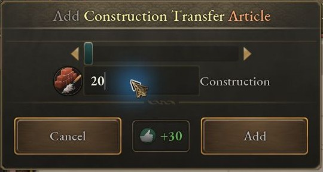](images/23_construction_quantity_dialog.jpg)

## Buildings — 道路・病院

**Roads (Transportation):** build from the construction menu and select farm road, flagstone, asphalt or expressway production methods. They provide infrastructure; paved methods also produce transportation. Higher methods consume more goods and require technologies, so check their input and output tooltips.

**Hospitals:** produce services and provide mortality and pollution-related modifiers. Religious and secular staffing methods depend on laws. Employment and input goods matter; an empty building does not deliver its fully staffed benefits.

**道路（交通施設）：** 建設メニューから建設し、農道・石畳・アスファルト・高速道路の生産方式を選択します。インフラを供給し、舗装方式では輸送も生産。上位方式の必要技術・投入財・産出はツールチップで確認してください。

**病院：** サービスを生産し、死亡率・汚染に関する補正を持ちます。宗教的・世俗的な運営方式は法律に依存します。雇用と投入財の確保が必要です。

View screenshots / 画像を見る（3枚）

### Hospital administration methods and effects

病院の運営方式・汚染と死亡率への効果

[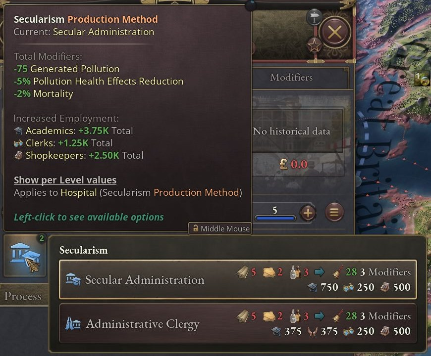](images/07_hospital_methods_effects.jpg)

### Hospital production, employment and input goods

病院の生産・雇用・投入財

[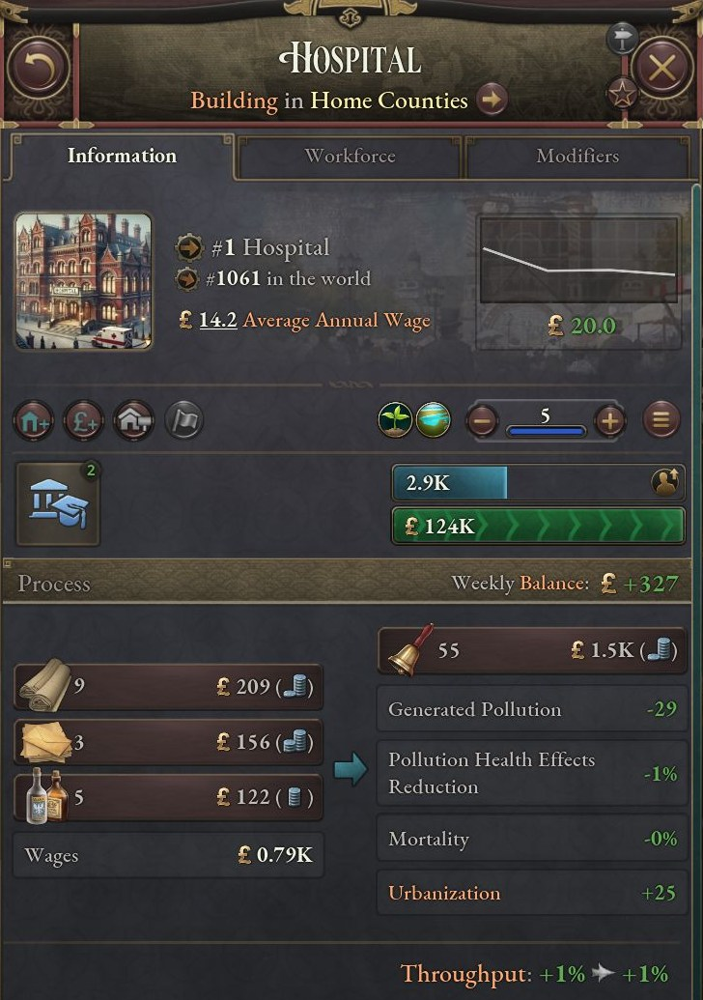](images/08_hospital_production.jpg)

### Transportation: Farm Road, Flagstone, Asphalt and Expressway

道路の４種類の生産方式

[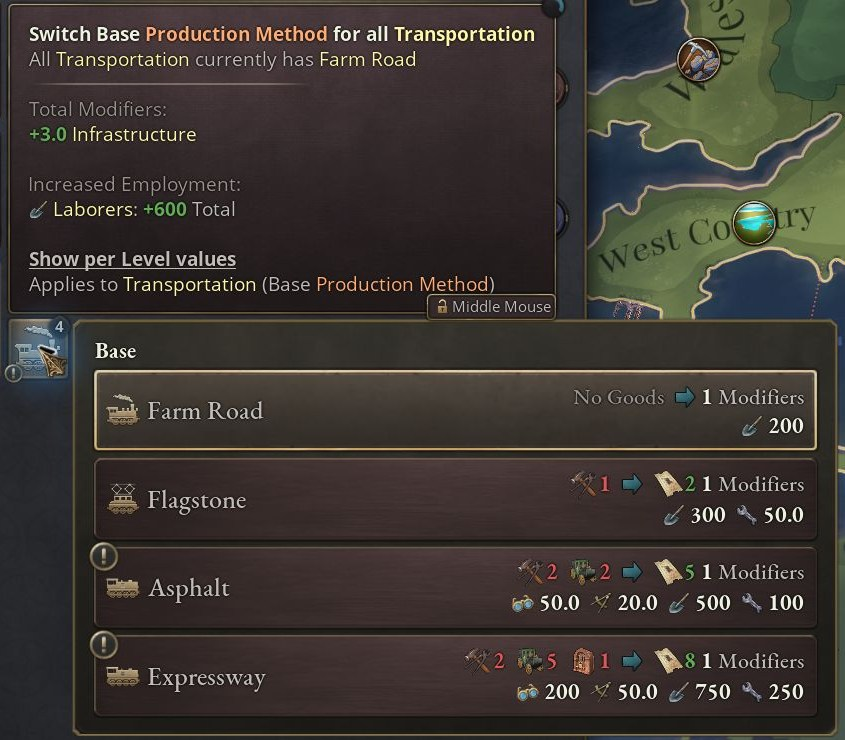](images/10_transportation_methods.jpg)

## Companies — 医療企業

**Medical Corporation:** inspect establishment conditions in the company panel. A hospital of at least level 3 is one requirement. Prosperity bonuses include +1.5 hospital workers' living standards, unit recovery, −20% healthcare institution bureaucracy costs and an academics' investment contribution modifier. These require prosperity; constructing a hospital alone does not activate all bonuses.

**医療法人：** 企業画面で設立条件を確認します。国内のレベル3以上の病院は条件の一つです。繁栄時は病院従業員の生活水準+1.5、部隊回復、医療制度の行政力費用−20%、学者の投資プール拠出補正などを得ます。病院を建てただけで全効果が有効になるわけではありません。

View screenshots / 画像を見る（1枚）

### Medical corporation and prosperity bonuses

医療企業の繁栄ボーナス

[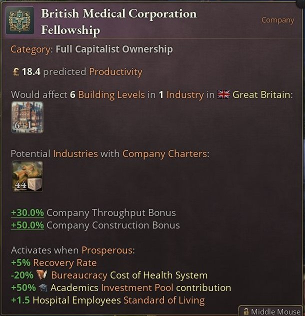](images/09_medical_company_prosperity.jpg)

Potential company preview, not an already prosperous company. / 未設立時のプレビューで、既に繁栄した企業の画面ではありません。

## Journals & Events — ジャーナルとイベント

**Overseas enterprises:** start from Decisions in the journal screen. Central Banking and an eligible direct subject with a free company slot are required. Monthly journal progress leads to events for choosing the subject and company. Technology, resources, land, existing companies and slots affect the options; this is not an instant company-grant button.

**Abandonment Policy:** choose an owned destination state with at most 500,000 people. Eligible discriminated populations relocate from incorporated states with at least one million people. With no eligible population, progress stops. The target is 200,000 relocations; completion has a five-year cooldown. Losing the destination ends the policy.

**海外企業設立：** ジャーナル画面のディシジョンから開始。中央銀行の研究と、企業枠に空きのある対象の直接従属国が必要です。月次進行後に対象国・企業の選択イベントが開きます。技術・資源・土地・既存企業・空き枠で選択肢が変わり、開始直後に企業を付与する機能ではありません。

**棄民政策：** 人口50万人以下の自国州を移住先に指定。人口100万人以上の編入州から、条件を満たす差別された住民を移住させます。対象者がいなければ進行しません。目標は20万人、完了後の待機期間は5年です。移住先を失うと終了します。

View screenshots / 画像を見る（6枚）

### Establishment of Overseas Enterprises

従属国での企業設立ジャーナル

[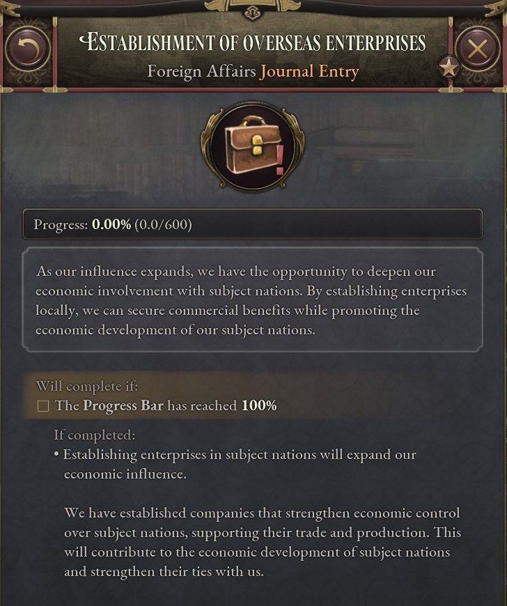](images/12_overseas_enterprises_journal.jpg)

Started through the original decision. / 元の開始ディシジョンから開始したジャーナルです。

### Choose a relocation destination

移住先の選択

[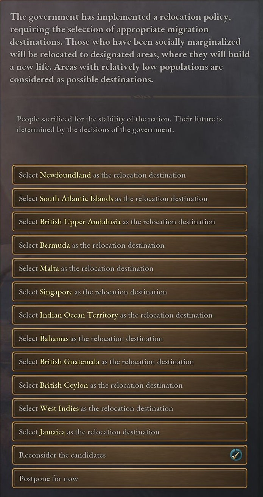](images/13_relocation_destination_selection.jpg)

The long event is cropped to its description and choices. / 長いイベントの本文と選択肢の接写です。

### Abandonment Policy journal

移住政策ジャーナル

[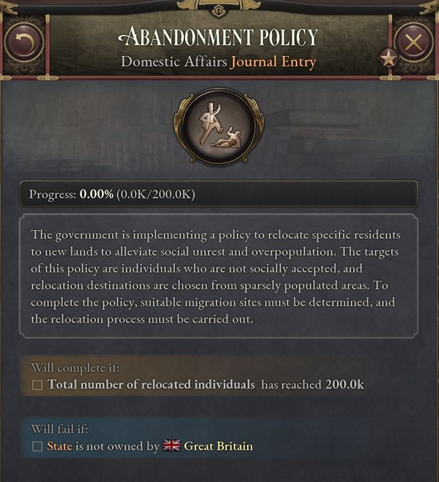](images/14_relocation_journal.jpg)

### Choose a subject for overseas company establishment

企業を設立する従属国の選択

[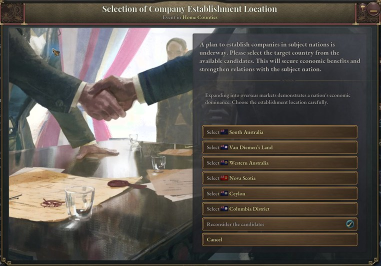](images/15_overseas_company_location.jpg)

The original event was opened by a photography-only decision to skip the journal wait. / 待ち時間を省く撮影用ディシジョンから元のイベントを開いています。

### Choose the company type

設立する企業の種類

[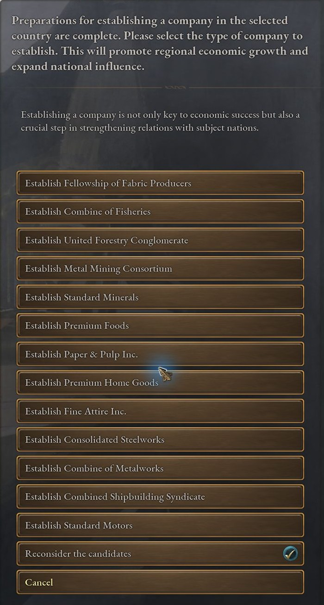](images/16_overseas_company_type.jpg)

Original company selection event; the long window is cropped to the choices. / 元の企業選択イベントの本文と選択肢を切り抜いています。

### Implementation of Relocation event

移住政策の継続イベント

[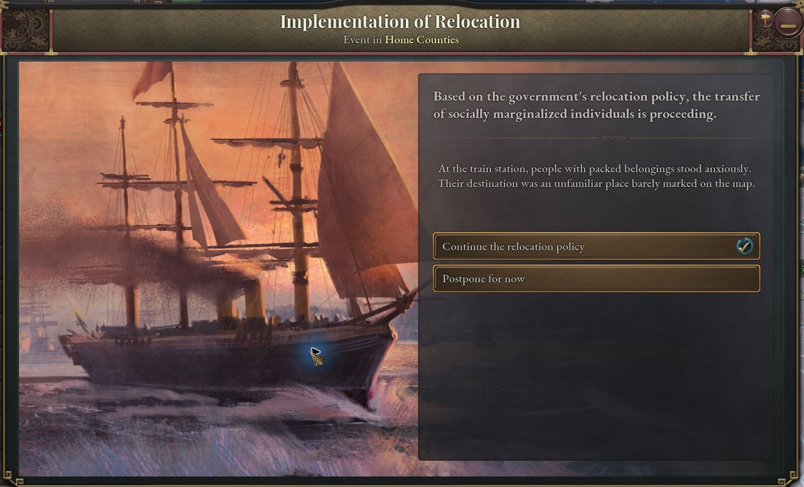](images/28_relocation_event.jpg)

## Diplomacy — 外交支援

**Check costs before proposing:** policing, food relief and policy support have different effects and upkeep. Their confirmation windows show influence, money and modifier costs; these are not free bonuses. Envoy dispatch has eligibility conditions and contributes to recognition progress, rather than guaranteeing instant recognition. The envoy screenshot shows an ineligible target.

**実行前に費用を確認：** 治安維持支援・食糧支援・政策支援はそれぞれ効果と維持費が異なります。確認画面で影響力・資金・自国への補正を確認してください。使節派遣には対象条件があり、承認の進捗を支援するもので即時承認を保証しません。掲載の使節画面は条件未達の例です。

View screenshots / 画像を見る（5枚）

### Additional subject support actions

追加の従属国支援アクション

[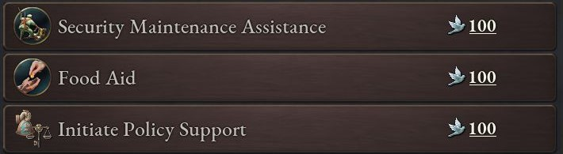](images/24_subject_actions.jpg)

### Security Maintenance Assistance: costs and effects

治安維持支援の費用・効果

[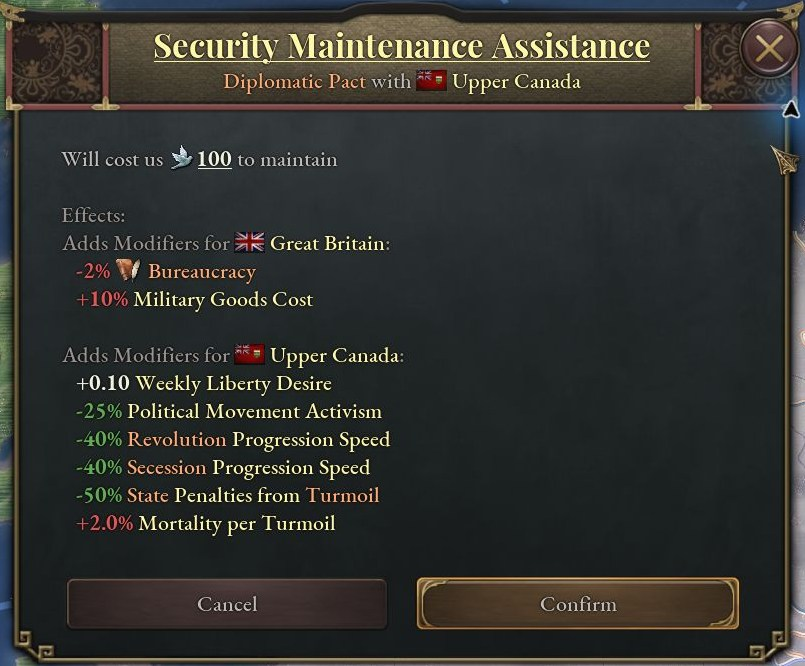](images/25_security_assistance.jpg)

### Food Aid: weekly cost and effects

食糧支援の週次費用・効果

[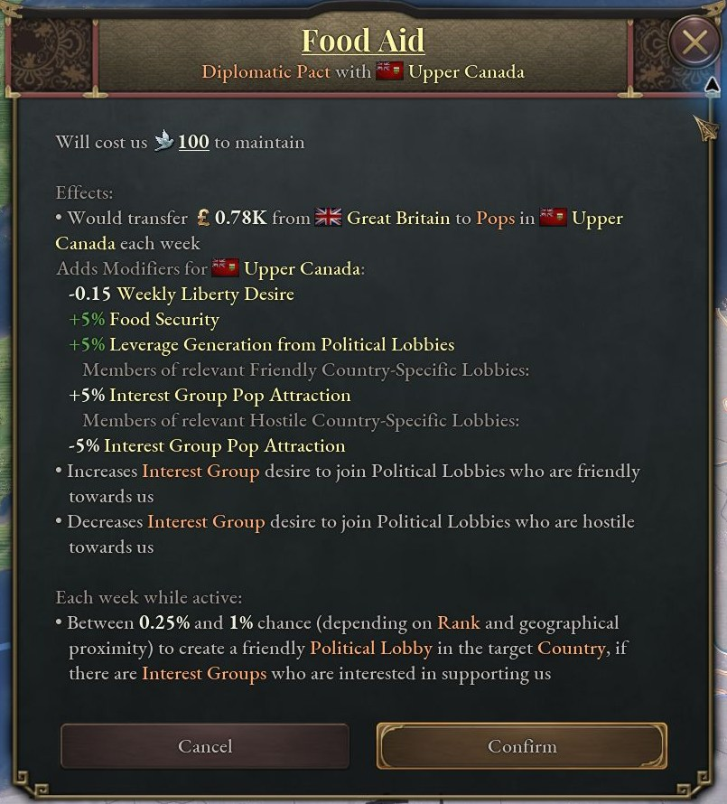](images/26_food_aid.jpg)

### Policy Support: enactment bonuses and costs

政策支援の立法ボーナス・費用

[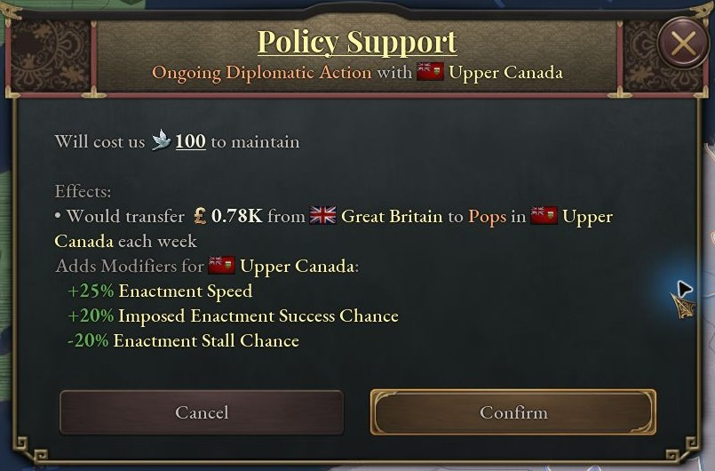](images/27_policy_support.jpg)

### Send Diplomatic Envoy: effects and eligibility

使節派遣の効果と実行条件（対象は条件未達）

[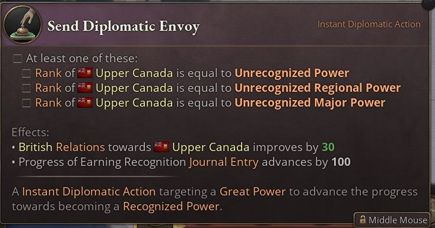](images/29_envoy_conditions.jpg)

Eligibility is not met by this recognized subject; this shows the conditions and effects, not a successful dispatch. / この対象国は条件未達です。派遣成功の画面ではなく条件・効果の紹介です。

## Statistics — NVGM Menu

**NVGM Menu:** switch between global investment, GDP rankings and subject comparisons. Use Reset where available to refresh/recalculate. Charts are snapshots, not forecasts. Some legacy labels remain untranslated; the capture notes explain omitted views.

**NVGM Menu：** 世界の投資プール、GDPランキング、従属国比較を切り替えて確認できます。Resetがある画面では更新・再集計が可能です。数値はその時点の集計で、将来予測ではありません。一部の旧ラベルは未翻訳のため、掲載範囲は撮影条件に記載しています。

View screenshots / 画像を見る（5枚）

### NVGM Menu

NVGM Menuの入口

[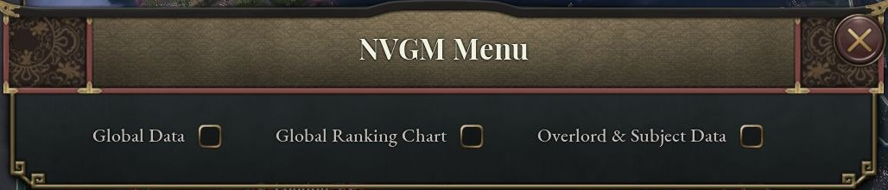](images/17_nvgm_menu.jpg)

### Global and foreign-investment-rights investment pools

世界と投資権保有国の投資プール

[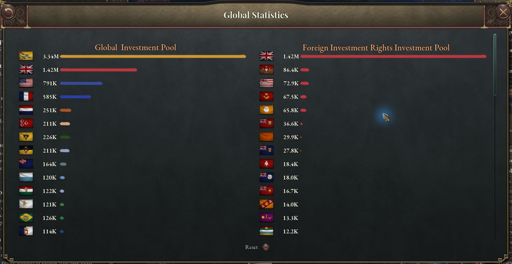](images/18_global_investment.jpg)

### GDP Top 10 chart and comparison controls

GDP上位10か国と比較表示

[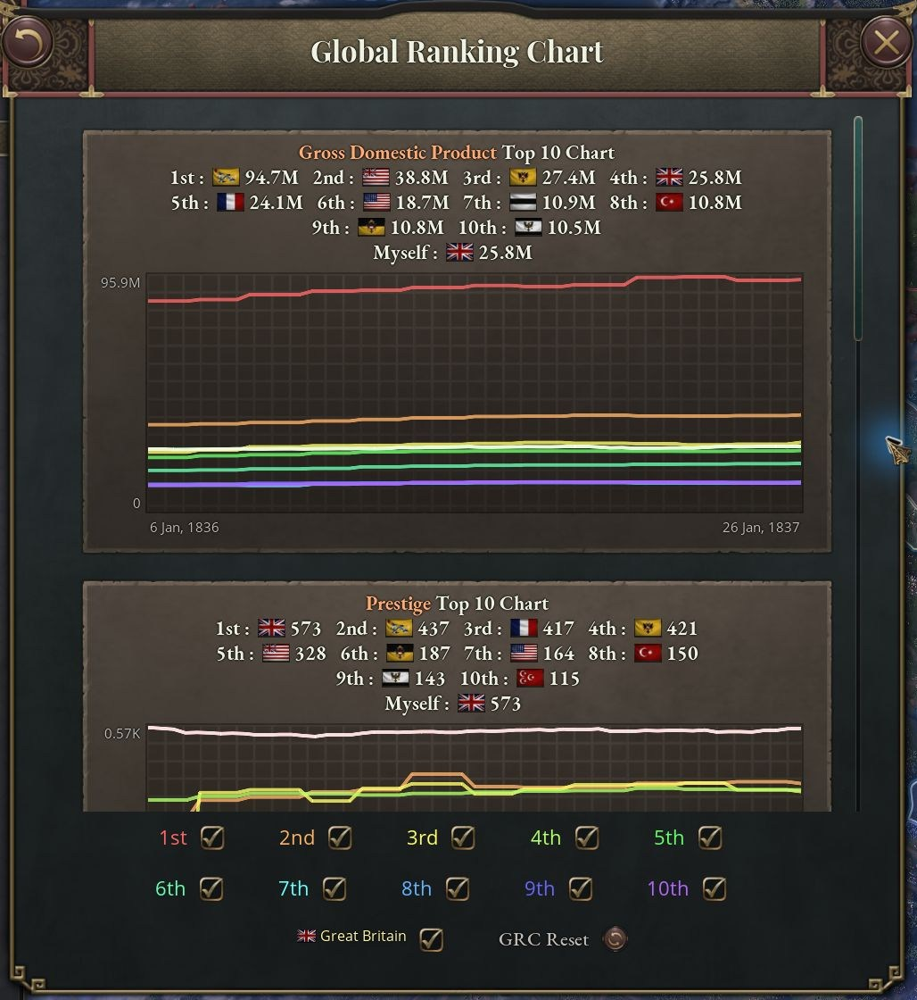](images/19_global_ranking.jpg)

### Overlord and subject investment pools

宗主国・従属国の投資プール

[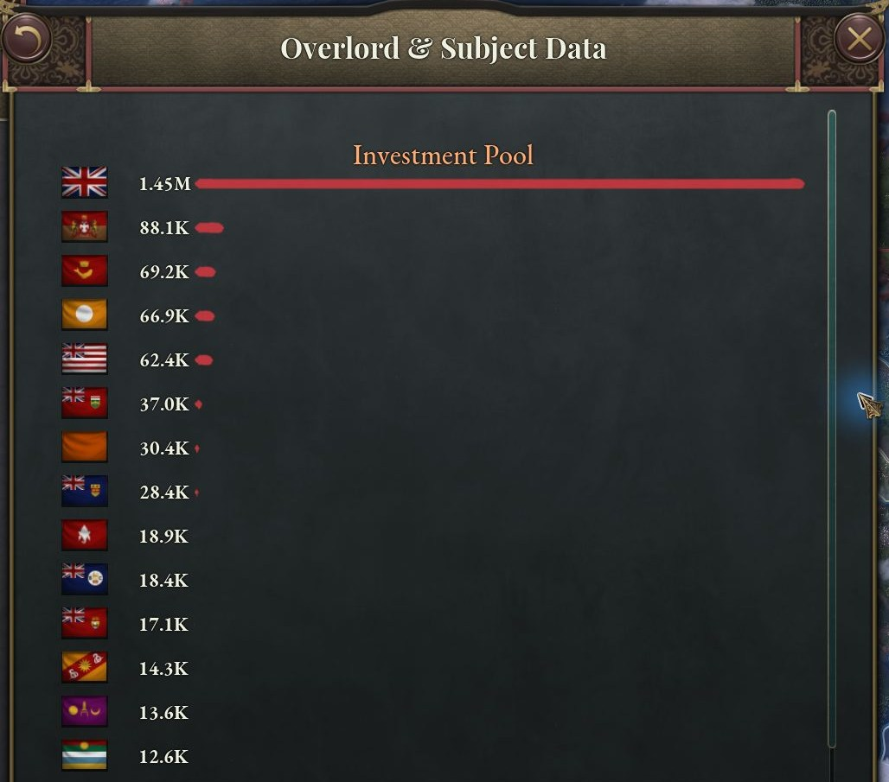](images/20_subject_investment.jpg)

### Compare researched technologies

従属国の研究済み技術数

[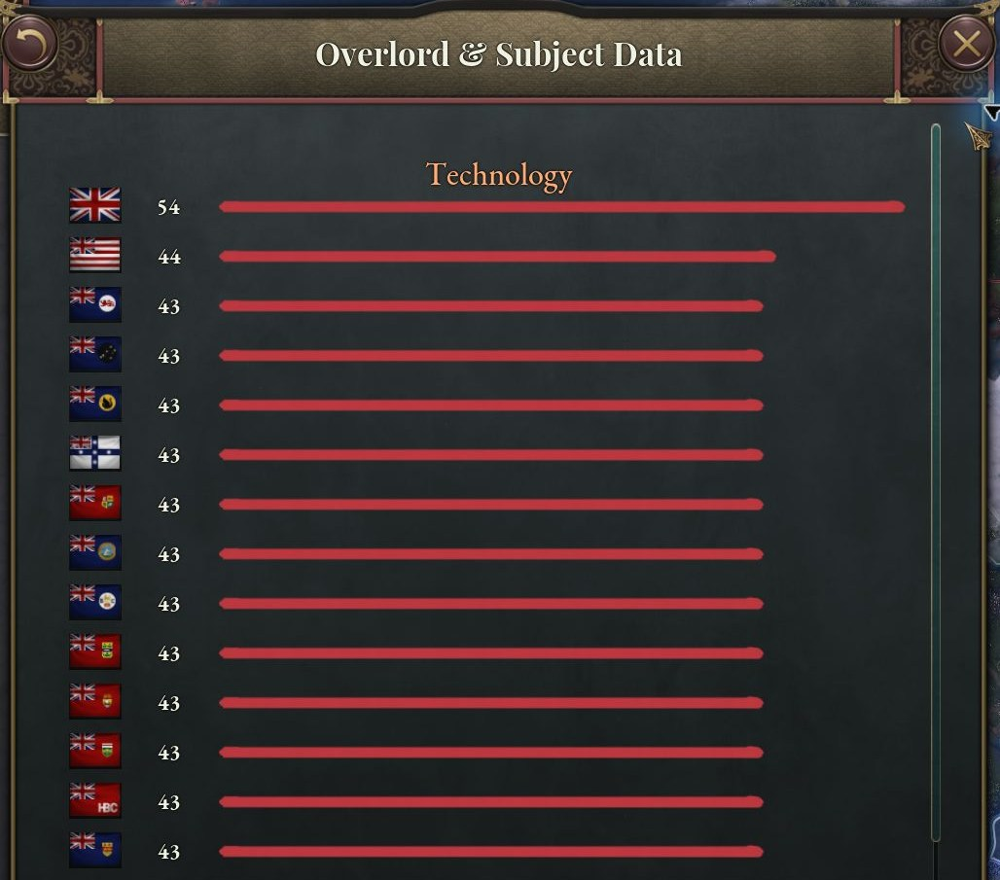](images/21_subject_technology.jpg)

## Capture notes / 撮影条件

- Buildings and technologies were prepared in an isolated photography profile. Figures are examples at different dates, not economic before/after comparisons. / 建物・技術は隔離した撮影環境で準備。数値は各撮影時点の例で、経済効果の比較試験ではありません。
- Draft treaties were not submitted during capture. / 撮影中の条約草案は送信していません。
- The subject strata chart still has Japanese labels in English mode and is excluded. Investment and technology close-ups omit that untranslated navigation button. / 階級割合は日本語が残るため未掲載。投資プール・技術比較は該当の日本語ボタンを含まないグラフ部分の接写です。
- These images do not cover every event branch, every industry or every production-method tooltip. / 全イベント分岐・全産業・全生産方式の個別ツールチップを網羅したものではありません。
- [Capture provenance and crop coordinates](capture_manifest.json) / 撮影元・切り抜き位置。
